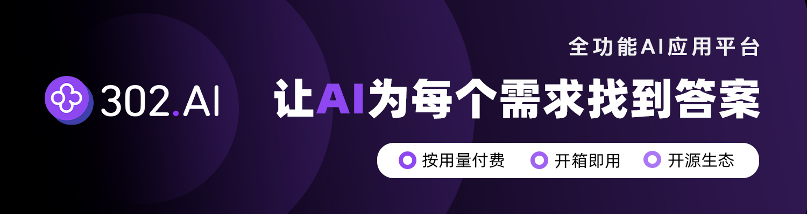

English | [简体中文](./README.md)

# MiGPT: Your Smart Home, More Thoughtful Than Ever ❤️

[](https://www.npmjs.com/package/mi-gpt) [](https://hub.docker.com/r/idootop/mi-gpt) [](https://hub.docker.com/r/idootop/mi-gpt) <a href="https://hellogithub.com/repository/e02e62fbb9c746cdb61c6559c186ac44" target="_blank"></a>

> 👉 Watch the full demo video: [Connect Xiaomi AI Speaker to ChatGPT and Doubao, Transform it into Your Personal Voice Assistant](https://www.bilibili.com/video/BV1N1421y7qn/?share_source=copy_web&vd_source=5d4e78ff2a0dc6a661baa65f479199c1)

<video src='https://github.com/idootop/mi-gpt/assets/35302658/dc336916-9087-418b-bc1b-04d5534dce8f'></video>

## 👋 Introduction

> [!TIP]
> If you're a Xiaomi AI Speaker Pro user, we recommend using [Open-XiaoAI](https://github.com/idootop/open-xiaoai) ✨
>
> Unlock new features like **custom wake words, continuous conversation, and Xiaozhi AI integration**

> [!IMPORTANT]
> The new [MiGPT-Next](https://github.com/idootop/migpt-next) has been released, and this project is no longer maintained ⚠️
>
> The new project fixes some known issues, supports custom message replies, and has better stability. We recommend [migrating](https://github.com/idootop/migpt-next) as soon as possible.

In this digital world, home is no longer just a place to live, but an extension of our digital lives.

`MiGPT` perfectly integrates Xiaomi AI speakers, Mi Home smart devices, with ChatGPT's understanding capabilities, making your smart home truly understand you.

`MiGPT` is not just about device automation, but about: **Creating a home that understands you, has warmth, and evolves with you**.

In the future, each of your smart home devices, from light bulbs and plugs to robot vacuums and TVs,

can act as independent intelligent agents, responding to your commands more intelligently and thoughtfully.

These independent agents can also perceive and cooperate with each other, forming a more powerful collaborative network.

And the Xiaomi AI speaker acts as your smart home's dedicated butler, serving you wholeheartedly and unleashing the true potential of smart homes.

## ✨ Key Features

- **🎓 AI Q&A**. Imagine when your Xiaomi AI speaker connects to large language models, it knows everything from astronomy to geography, instantly transforming from "artificial stupidity" to a genius.
- **🎭 Role Playing**. Train your Xiaomi AI in seconds - whether becoming your perfect companion or that caring best friend who listens to your thoughts, it's all possible.
- **💬 Streaming Response**. Love comes fast like a tornado, and so does your Xiaomi AI speaker - instant replies showing love that won't keep you waiting.
- **🧠 Long & Short-term Memory**. Your Xiaomi AI speaker can now remember every conversation between you two, becoming more in sync as you chat, just like an old friend by your side.
- **🔊 Custom TTS**. Tired of Xiaomi's voice? Unlock [Doubao](https://doubao.com)'s voice tones, making it sound like a real person replying to your messages.
- ~**🤖️ Smart Home Agent**. Feeling down? Xiaomi AI instantly understands and automatically plays your favorite music, adjusts lighting, and cheers you up.~

## 🦄 Sponsors



> 302.AI is a pay-as-you-go one-stop AI application platform with an open platform and open-source ecosystem. [Official Website](https://302.ai) | [Introduction](https://help.302.ai)

## ⚡️ Quick Start

### Video Tutorial

👉 [MiGPT Lightning-Fast Tutorial - Step-by-Step Guide to Training Your Xiaomi AI Speaker](https://www.bilibili.com/video/BV1zb421H7cS)

### Device Requirements

`MiGPT` supports most Xiaomi AI speaker models, with Xiaomi AI Speaker Pro recommended (runs perfectly)

👉 [View more compatible Xiaomi AI speaker models and configuration parameters](https://github.com/idootop/mi-gpt/blob/main/docs/compatibility.md)

> Note: This project does not currently support Baidu Xiaodu, Tmall Genie, HomePod, or other smart speakers, and there are no plans for adaptation.

### Usage Methods

`MiGPT` has two startup methods: [Docker](#docker) and [Node.js](#nodejs).

After successful startup, you can summon AI to answer questions in the following ways:

- **Xiaoai, please xxx**. For example: `Xiaoai, please tell me why the Earth is round?`
- **Xiaoai, you xxx**. For example: `Xiaoai, do you like me?`
- **Xiaoai, summon xxx**. For example: `Xiaoai, summon Shanniu`

### Docker

[](https://hub.docker.com/r/idootop/mi-gpt)

For beginners or those who don't want to configure the code runtime environment (Node) themselves, you can use Docker startup.

Please first configure your `.env` and `.migpt.js` files according to [⚙️ Parameter Settings](https://github.com/idootop/mi-gpt/blob/main/docs/settings.md), then use the following command to start docker:

```shell
docker run -d --env-file $(pwd)/.env -v $(pwd)/.migpt.js:/app/.migpt.js idootop/mi-gpt:latest
```

Note: In Windows terminal, you need to replace the configuration file path `$(pwd)` with an absolute path.

### Node.js

[](https://www.npmjs.com/package/mi-gpt)

If you're a frontend (Node) developer, you can also install `mi-gpt` via NPM to start `MiGPT`.

```shell
npm install mi-gpt # Install dependencies
```

Then, create and start a `MiGPT` instance. For detailed parameter descriptions, please refer to [⚙️ Parameter Settings](https://github.com/idootop/mi-gpt/blob/main/docs/settings.md).

```typescript
import { MiGPT } from "mi-gpt";

async function main() {
  const client = MiGPT.create({
    speaker: {
      userId: "987654321", // Note: Not phone number or email, check in "Personal Info" - "Xiaomi ID"
      password: "123456", // Account password
      did: "小爱音箱Pro", // Xiaomi AI speaker ID or name set in Mi Home
    },
  });
  await client.start();
}

main();
```

Note: In this mode, configuration from `.env` and `.migpt.js` is not automatically read. You need to manually initialize Node environment variables and pass parameters from `.migpt.js` as initialization parameters to `MiGPT.create`. 👉 [Example Code](https://github.com/idootop/mi-gpt/blob/example/index.ts)

## 📖 Documentation

Tip: Most questions can be answered in [💬 FAQ](https://github.com/idootop/mi-gpt/blob/main/docs/faq.md).

- [🔥 Official Video Tutorial](https://www.bilibili.com/video/BV1zb421H7cS)
- [⚙️ Parameter Settings](https://github.com/idootop/mi-gpt/blob/main/docs/settings.md)
- [💬 FAQ](https://github.com/idootop/mi-gpt/blob/main/docs/faq.md)
- [🔊 Using Third-party TTS](https://github.com/idootop/mi-gpt/blob/main/docs/tts.md)
- [🛠️ Local Development](https://github.com/idootop/mi-gpt/blob/main/docs/development.md)
- [💎 How It Works](https://github.com/idootop/mi-gpt/blob/main/docs/how-it-works.md)
- [🦄 Sponsors](https://github.com/idootop/mi-gpt/blob/main/docs/sponsors.md)
- [✨ Changelog](https://github.com/idootop/mi-gpt/blob/main/docs/changelog.md)
- [🚀 Roadmap](https://github.com/idootop/mi-gpt/blob/main/docs/roadmap.md)

## 🔗 Related Projects & Tutorials

| Project Link                                                                                                                                                                                                                         | Description                                                                                                                                             | Source                                               |
| ------------------------------------------------------------------------------------------------------------------------------------------------------------------------------------------------------------------------------------ | ------------------------------------------------------------------------------------------------------------------------------------------------------- | ---------------------------------------------------- |
| **Related Projects**                                                                                                                                                                                                                 |                                                                                                                                                         |                                                      |
| [MiGPT GUI](https://migptgui.com/)                                                                                                                                                                                                   | Create and manage MiGPT through a graphical interface, supports running multiple accounts                                                               | [@lmk123](https://github.com/lmk123)                 |
| [MiGPT Configuration Center](https://github.com/LipapaSma/mi-gpt-vue)                                                                                                                                                                | Vue-based MiGPT visual configuration interface, providing intuitive service management and parameter configuration capabilities                         | [@LipapaSma](https://github.com/LipapaSma)           |
| [@shinedlc/mi-gpt](https://github.com/shinedlc/mi-gpt)                                                                                                                                                                               | MiGPT fork with camera module support, allowing Xiaomi AI to see and understand the real world                                                          | [@shinedlc](https://github.com/shinedlc)             |
| **Tutorials**                                                                                                                                                                                                                        |                                                                                                                                                         |                                                      |
| [MiGPT Official Video Tutorial](https://www.bilibili.com/video/BV1zb421H7cS)                                                                                                                                                        | Official tutorial PPT file 👉 [MiGPT Tutorial.pdf](https://github.com/idootop/mi-gpt/blob/main/assets/pdf/MiGPT%E5%AE%98%E6%96%B9%E6%95%99%E7%A8%8B.pdf) | [@idootop](https://github.com/idootop)               |
| [MiGPT Integration with Doubao and Other LLMs Tutorial](https://migptgui.com/docs/apply/)                                                                                                                                           | Detailed integration tutorials for Doubao, Moonshot (Kimi), and other common large language models                                                     | [@lmk123](https://github.com/lmk123)                 |
| [Quick MiGPT Installation via Docker, Step-by-Step Guide to Bypass Remote Login Risk Control](https://www.nodeseek.com/post-264959-1)                                                                                               | Beginner-friendly tutorial with almost entirely graphical interface                                                                                     | [@Jasonzhu1207](https://github.com/Jasonzhu1207)     |
| [Xiaomi AI Speaker PRO AI Mode User Guide](https://github.com/idootop/mi-gpt/blob/bbdb80e9bc38b7c40865e52cbd6517980a68615a/assets/pdf/%E5%B0%8F%E7%88%B1%E9%9F%B3%E7%AE%B1PRO%20AI%E6%A8%A1%E5%BC%8F%E4%BD%BF%E7%94%A8%E8%AF%B4%E6%98%8E.pdf) | A thoughtful tutorial prepared by a dad for his children                                                                                                | [@mxyblog](https://github.com/mxyblog)               |
| [Using MiGPT to Connect Your Xiaomi AI Speaker to ChatGPT](https://www.iloli.love/archives/1719073913220)                                                                                                                           | Detailed guide on using [OneAPI](https://github.com/songquanpeng/one-api) on 1Panel to convert Tencent Hunyuan and iFlytek Spark model APIs for MiGPT | [@miaowmint](https://github.com/miaowmint)           |
| [Deploying MiGPT on Unraid](https://github.com/idootop/mi-gpt/blob/adfdcc4ee51aef8d4f2d8996f18be716da19a0ad/assets/pdf/Unraid%E9%83%A8%E7%BD%B2MiGPT.pdf)                                                                            | Detailed tutorial for deploying MiGPT using Docker on Unraid                                                                                            | [@ilovesouthpark](https://github.com/ilovesouthpark) |

## ❤️ Acknowledgments

Special thanks to the following projects for implementation references:

- https://github.com/yihong0618/xiaogpt
- https://github.com/jialeicui/open-lx01
- https://github.com/inu1255/mi-service
- https://github.com/Yonsm/MiService

## 🚨 Disclaimer

This project is for learning and research purposes only and must not be used for any commercial activities. Users should comply with local laws and regulations when using this project. The project and its authors are not responsible for any consequences arising from illegal use.
This project may have unknown defects and risks (including but not limited to device damage and account bans). Users assume all risks and responsibilities arising from the use of this project.
The authors do not guarantee the accuracy, completeness, timeliness, or reliability of this project, nor do they assume any liability for any losses or damages arising from the use of this project.
By using this project, you acknowledge that you have read and agree to all terms of this disclaimer.

## License

[MIT](https://github.com/idootop/mi-gpt/blob/main/LICENSE) License © 2024-PRESENT Del Wang